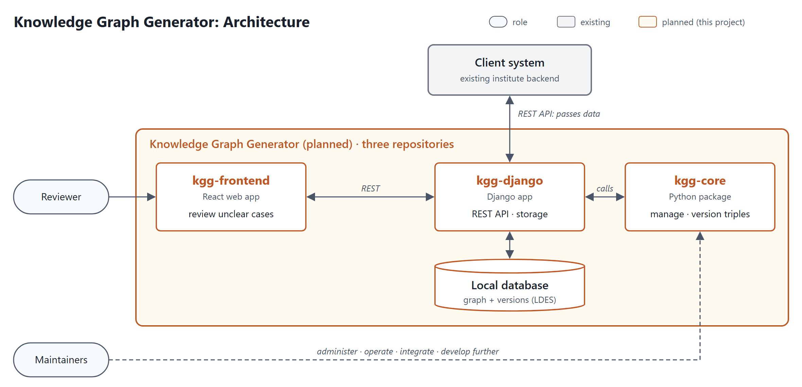

# Knowledge Graph Generator: Specification

**Teamprojekt Softwareentwicklung 2026/27, TU Darmstadt · Team 080**
**Client:** Ning Xia, Research Data Management Group, Chair of Fluid Systems, TU Darmstadt
**Team:** Surkhabjit Singh, Mahdi Rafiei, Mohammad Riad Loutfi, Arian Faruqui, Denis Ücyildiz, M Adel Zitouni
**Version:** 13.11.2026

## 1. Project Description

### Vision

Our client is building an information retrieval system that collects mostly unstructured data from different sources and makes it searchable. Knowledge graphs store its relations in a structured, queryable way, but building them by hand takes time and expert knowledge and leads to inconsistencies. The Knowledge Graph Generator (KGG) manages and versions graphs built from raw data and a given ontology, and lets a human decide where the system cannot. In the long term, the client wants the KGG to run permanently in the institute's backend as its own project that they keep developing.

### Current and Target State

The institute runs a search portal with a React frontend and a Django backend that uses, among others, the graph database Fuseki. Contrary to the call for projects, the client made clear that generating the graph is not the focus, because it is still mostly a research problem. Instead, the KGG receives ready-made triples, so that a generation step can be added later. Its goals are a REST API to add, read, edit and update triples, versioning of every change with Linked Data Event Streams (LDES), checks against the existing graph that avoid duplicate entities, and a review step in which a person decides unclear cases (human-in-the-loop). We agreed with the client that the KGG gets its own backend with a Python core, called by the institute's backend over a REST API, plus a simple frontend for the reviewer. We propose to build this backend as a Django app that the institute could also install directly. The client values software the institute can maintain and extend, and code the team fully understands.

### Domain

A knowledge graph stores facts as triples of subject, predicate and object. RDF is a standard format for these triples, and an ontology defines the allowed classes and relations. LDES describes changes to an RDF graph as a stream of versions, so older states can be restored. Three roles work with the KGG: the client system, currently the institute's backend, sends triples over our REST API and gets the results back; the reviewer decides unclear cases in the frontend; the maintainers, developers at the institute, run, integrate and further develop the KGG. Other stakeholders are the client, who sets priorities and accepts requirements, and our course supervisor. Constraints are the integration into the institute's Django backend, a local database for now, open-source publication and a final handover to the institute's GitLab.

### Architecture

*Figure 1: Planned architecture. The split into three repositories is our proposal and still has to be confirmed by the client.*
